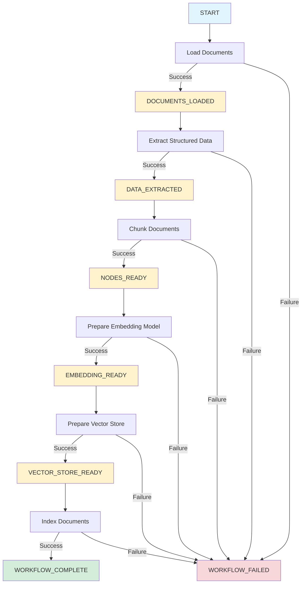
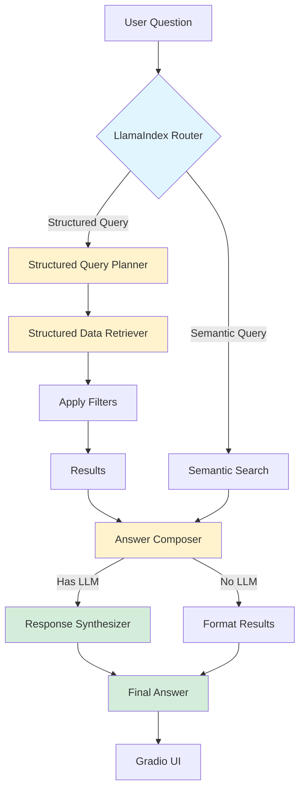
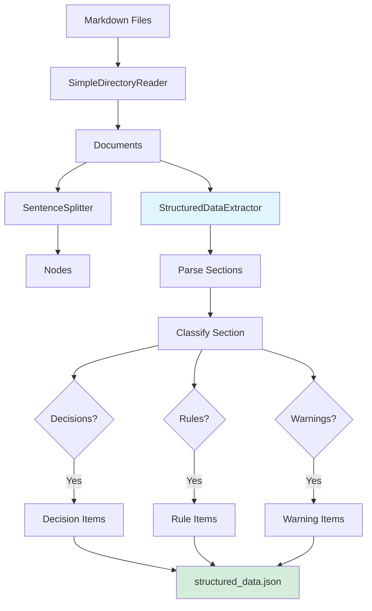
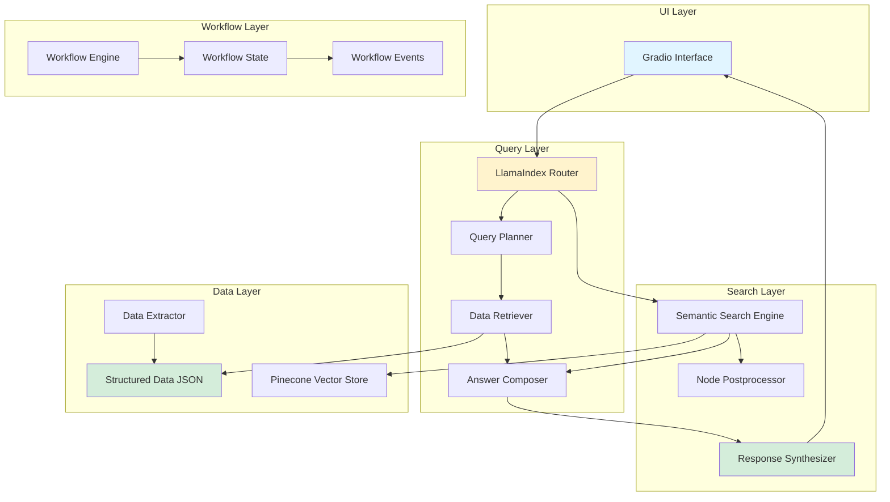

# Workflow Diagram

## Event-Driven Architecture Flow

## Query Processing Flow

## Data Extraction Flow

## Component Architecture

## Key Components

### LlamaIndex Components Used
- **SimilarityPostprocessor**: Filters search results by similarity score
- **Response Synthesizer**: Generates natural language responses from retrieved context
- **LLMSingleSelector**: Intelligently routes queries between semantic and structured search
- **QueryEngineTool**: Tools used by the router for decision making

### Custom Components
- **StructuredDataExtractor**: Extracts decisions, rules, and warnings from markdown
- **LlamaIndexRouter**: Wrapper around LlamaIndex selector with fallback logic
- **WorkflowEngine**: Event-driven workflow engine with state management
- **SimpleSemanticFallback**: Fallback semantic search when vector store unavailable
